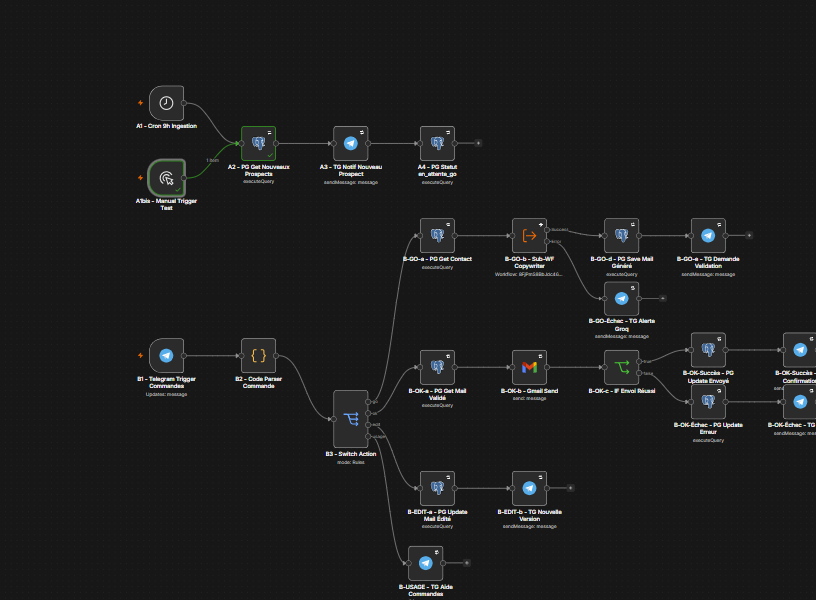
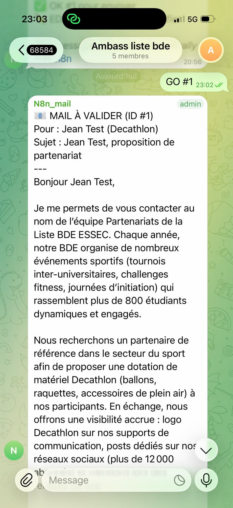
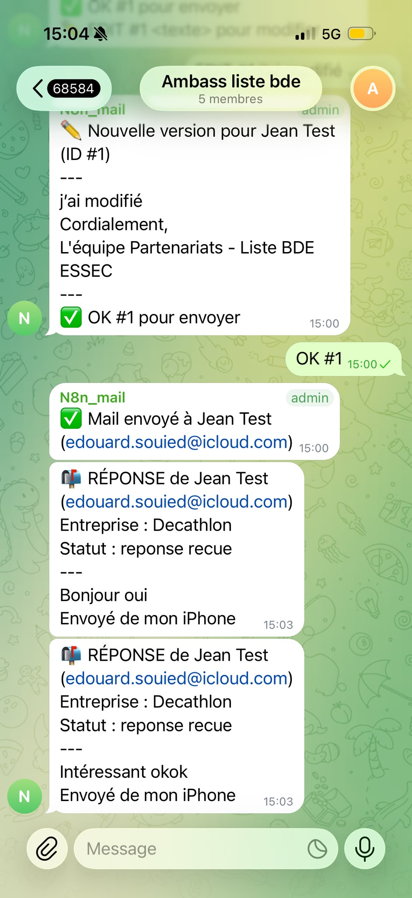
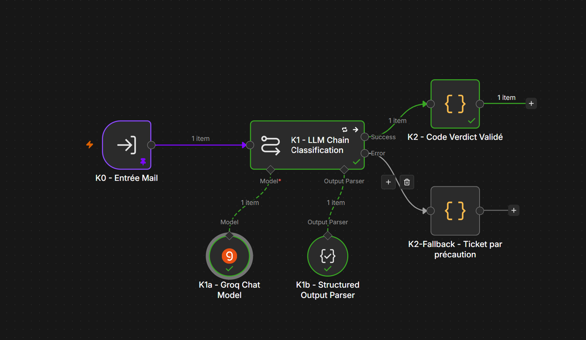
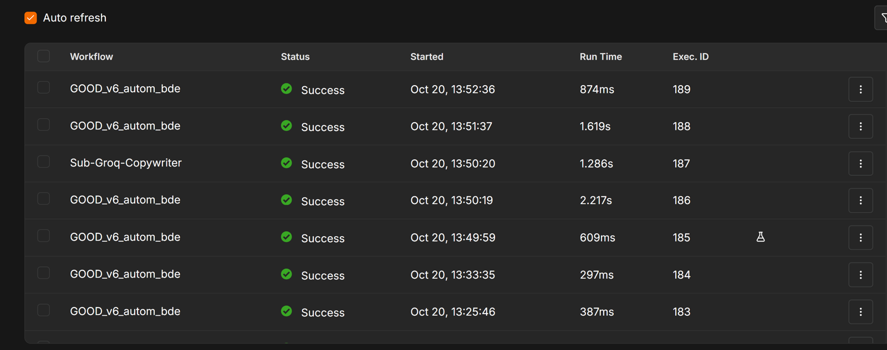

# BDE PartnerBot

**Autonomous B2B partnership outreach for a student union (BDE), with human-in-the-loop AI copywriting and AI-powered inbox triage, built on n8n.**

> **The need in one sentence:** the partnership team of the ESSEC BDE loses hours every week because it writes every sponsor email by hand in Gmail, tracks follow-ups in a Google Sheet and reads a shared inbox full of spam to find the few real partner replies.

Author: **Edouard Souied** · AIDAMS 3A · n8n Level 3
Full scoping document and architecture diagram: [`docs/BDE_PartnerBot_Scoping_Deliverable_v2.pdf`](docs/BDE_PartnerBot_Scoping_Deliverable_v2.pdf)

---

## What it does

| Module | Trigger | What happens |
|---|---|---|
| **A · Ingestion** | Schedule, daily 09:00 (Europe/Paris) + manual trigger | New prospects (`statut = nouveau`) are posted in the team's Telegram group. |
| **B · Commands** | Telegram message | `GO #id` → an AI sub-workflow drafts a personalized HTML pitch for review. `EDIT #id text` → replaces the draft. `OK #id` → sends it with Gmail. Malformed commands get a usage message. |
| **C · Follow-ups** | Schedule, every 6 days | Up to 3 automatic follow-ups per prospect, then `pas_de_reponse`. |
| **D · Inbox triage** | Gmail, polled every minute | Replies from known prospects update the CRM (`reponse_recue`) and alert the group. Emails from unknown senders are classified by an AI sub-workflow; only BDE / partnership-related ones become support tickets. |

### Workflows (in [`workflows/`](workflows))

| File | Role |
|---|---|
| `01_main_GOOD_v6_autom_bde.json` | Main workflow: modules A, B, C, D |
| `02_sub_groq_copywriter.json` | Sub-workflow: writes the HTML pitch (Groq, GPT-OSS 120B) |
| `03_sub_ai_mail_classifier.json` | Sub-workflow: Basic LLM Chain + Groq Chat Model (GPT-OSS 20B) + Structured Output Parser, with a fallback path |
| `04_error_handler.json` | Error workflow: logs any failure in `error_log` and alerts Telegram with the workflow name and execution URL |

### Stack

| Service | Image (pinned) | Role |
|---|---|---|
| n8n | `docker.n8n.io/n8nio/n8n:2.25.7` | Workflow engine |
| postgres-bde | `postgres:15.18` | Business database (`contacts`, `support_tickets`, `error_log`) |
| pgadmin | `dpage/pgadmin4:9.16` | Database UI |

Data is stored in named volumes (`n8n_data`, `bde_pgdata`, `bde_pgadmin_data`), so it survives `docker compose down` / `up`. n8n only starts once Postgres passes its `pg_isready` healthcheck.

---

## Repository structure

```
bde-partnerbot/
├── docker-compose.yml      # n8n + Postgres + pgAdmin, pinned versions, named volumes, healthcheck
├── .env.example            # every required variable, with placeholder values
├── .gitignore              # ignores .env, backups and local data
├── db/init.sql             # schema + one demo contact, run automatically on an empty database
├── workflows/              # the 4 n8n workflows exported as JSON (same version as the demo)
└── docs/                   # scoping deliverable (PDF), demo SQL runbook, screenshots
```

---

## Setup: from a fresh clone to a running system

### 1. Prerequisites
- Docker Desktop (or Docker Engine + Compose v2)
- A Telegram bot token (from @BotFather) and a Telegram group where the bot is admin
- A Groq API key ([console.groq.com](https://console.groq.com))
- A Gmail / Google Workspace account (OAuth2 credentials)
- A public HTTPS URL pointing to port 5678 for the Telegram webhook (we use a Cloudflare Tunnel; ngrok also works)

### 2. Clone and configure
```bash
git clone https://github.com/edouard-sd/bde-partnerbot.git
cd bde-partnerbot
cp .env.example .env        # Windows PowerShell: copy .env.example .env
```
Edit `.env` and fill in the values (see the table below). **Never commit `.env`**: it is git-ignored.

### 3. Start the stack
```bash
docker compose up -d
docker compose ps           # postgres-bde must show "(healthy)", n8n and pgadmin "Up"
```
- n8n: <http://localhost:5678> (create the owner account on first launch)
- pgAdmin: <http://localhost:5050> (log in with `PGADMIN_DEFAULT_EMAIL` / `PGADMIN_DEFAULT_PASSWORD`, then register a server with host `postgres-bde`)
- On an empty volume, `db/init.sql` creates the three tables and a demo contact.

### 4. Import the workflows
```bash
docker cp workflows n8n:/tmp/workflows
docker exec n8n n8n import:workflow --separate --input=/tmp/workflows
```

### 5. Create the credentials in n8n (*Credentials → Create*)
| Credential | Type | Value |
|---|---|---|
| Postgres-BDE | Postgres | Host `postgres-bde`, port `5432`, database / user / password from `.env` |
| Groq account | Groq | Groq API key |
| Header Auth account | Header Auth | Name `Authorization`, value `Bearer <GROQ_API_KEY>` |
| Telegram account | Telegram API | Bot token |
| Gmail account | Gmail OAuth2 | Google OAuth client |

Open each workflow and select these credentials on the nodes that show a warning. Replace the Telegram group ID (`-1004453819959`) with your own group ID in the Telegram nodes and in the `B2 - Code Parser Commande` node (`ALLOWED_CHAT_ID`).

### 6. Publish (order matters)
1. Publish `Sub-Groq-Copywriter`, `Sub-AI-Mail-Classifier` and `Error Handler - BDE PartnerBot`.
2. In `GOOD_v6_autom_bde` → *Settings*: set **Error Workflow** = `Error Handler - BDE PartnerBot` and **Timezone** = `Europe/Paris`.
3. Publish `GOOD_v6_autom_bde`.

---

## Environment variables

| Variable | Description | Example |
|---|---|---|
| `POSTGRES_USER` | Postgres user | `postgres` |
| `POSTGRES_PASSWORD` | Postgres password | *(secret)* |
| `POSTGRES_DB` | Business database | `contacts_bde` |
| `N8N_ENCRYPTION_KEY` | Key that encrypts n8n credentials. Random for a new install; **must be the existing key** when migrating an instance | *(secret)* |
| `N8N_HOST` | Public host name of n8n | `n8n.example.com` |
| `N8N_PROTOCOL` | Public protocol | `https` |
| `WEBHOOK_URL` | Public base URL used for the Telegram webhook (also the editor URL) | `https://n8n.example.com` |
| `PGADMIN_DEFAULT_EMAIL` | pgAdmin login | `admin@example.com` |
| `PGADMIN_DEFAULT_PASSWORD` | pgAdmin password | *(secret)* |

---

## How to test

Reset the demo contact first (pgAdmin → Query Tool):
```sql
UPDATE contacts SET statut='nouveau', mail_genere=NULL, mail_sujet=NULL, date_premier_contact=NULL,
  date_mail_envoye=NULL, reponse_date=NULL, reponse_body=NULL, nombre_relances=0, erreur_message=NULL,
  date_derniere_relance=NULL, date_derniere_tentative=NULL WHERE id=1;
```

| # | Action | Expected result |
|---|---|---|
| 1 | Run `A1bis - Manual Trigger Test` from the canvas | Telegram: *🆕 NOUVEAU PROSPECT (ID #1)*, status `en_attente_go` |
| 2 | Telegram: `GO #1` | Telegram: *📧 MAIL À VALIDER* with the AI draft |
| 3 | Telegram: `EDIT #1 Bonjour, version validée.` | Telegram: *✏️ Nouvelle version* |
| 4 | Telegram: `OK #1` | Telegram: *✅ Mail envoyé*, email received, status `mail_envoye` |
| 5 | Telegram: `GO #1` again | Nothing happens (idempotent: the pitch was already sent) |
| 6 | Telegram: `GO 1` (missing `#`) | Telegram: usage message listing the valid commands |
| 7 | Reply to the email from the prospect's mailbox | Within 1 to 3 min, Telegram: *📬 RÉPONSE*, status `reponse_recue` |
| 8 | Email the inbox from an unknown address about a partnership | Telegram: ticket alert with *🤖 Classé : partenariat*, new row in `support_tickets` |
| 9 | Email the inbox from an unknown address with an advert | Nothing on Telegram (classified as not relevant), email stays unread |
| 10 | SQL: `UPDATE contacts SET date_derniere_relance = NOW() - INTERVAL '7 days' WHERE id=1;` then run `C1` from the canvas | Follow-up email received, Telegram *🔁 Relance envoyée… n°1* |

All demo SQL queries, in order, are in [`docs/demo_SQL_BDE_PartnerBot.txt`](docs/demo_SQL_BDE_PartnerBot.txt).

---

## Robustness

- **Retry On Fail** (3 tries, 1 s wait) on every Postgres, Gmail, Telegram and HTTP node; 3 tries on the AI calls.
- **Error Workflow**: any unhandled failure is written to `error_log` and pushed to Telegram with the workflow name, node and execution URL.
- **Validated AI output**: the classifier's verdict must match a JSON schema (Structured Output Parser); otherwise a fallback path creates a ticket (fail-open).
- **Idempotency**: every command checks the contact's status first, so a pitch cannot be generated or sent twice.
- **Input validation**: only the BDE group's chat ID is accepted; malformed commands get a usage message.
- **Safe SQL**: positional query parameters everywhere.

---

## Screenshots

| | |
|---|---|
| Main workflow canvas |  |
| AI draft in Telegram (GO) |  |
| Prospect reply alert |  |
| AI classifier sub-workflow |  |
| Executions tab |  |

---

## Security notes

- Secrets live only in `.env` (git-ignored) and in n8n's encrypted credential store; workflow JSON files contain credential **references**, never values.
- Ports are bound to `127.0.0.1`; only n8n is exposed publicly, through the HTTPS tunnel.
- The email domain is authenticated with SPF, DKIM and DMARC.
